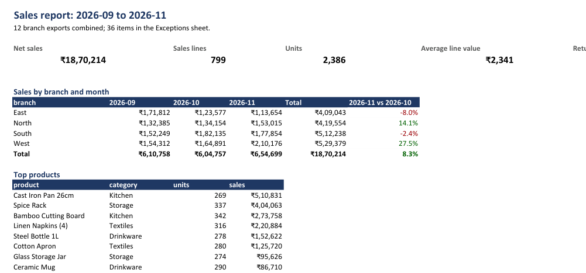
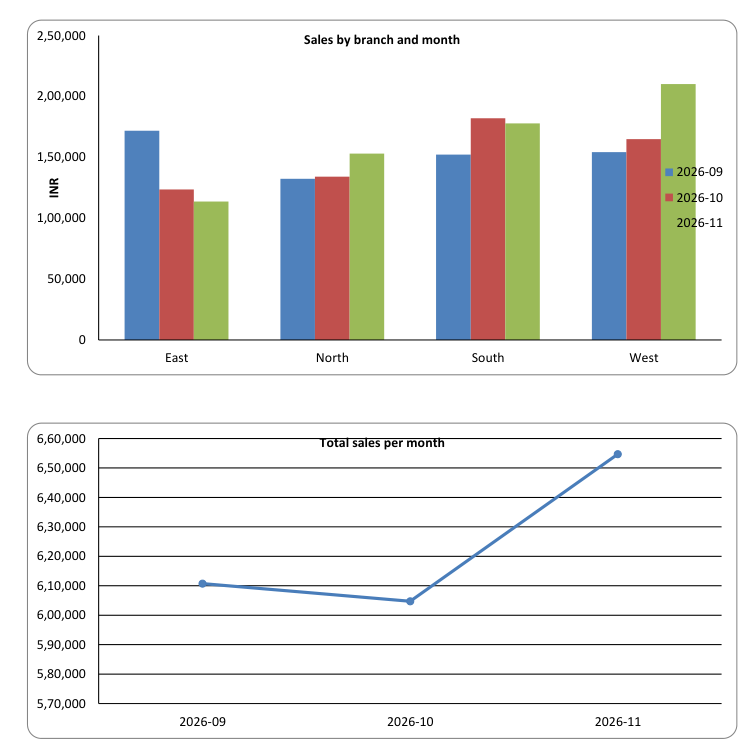

# Excel report automation: messy branch exports to one finished report

Every month someone copies sales exports from several branches into one spreadsheet, fixes the columns, removes duplicates, builds the summary tables and charts, and writes a short update for the manager. This does all of it in under a second, the same way every time, and lists everything it had to fix or leave out.

All branches, products and figures in the samples are invented.



## The problem

Each branch's system exports differently:

| Branch | Format | Column names | Dates | Amounts | Extra mess |
|---|---|---|---|---|---|
| North | CSV | Order No, Order Date, Product, Qty, Unit Price, Total | 03/11/2026 (day first) | `1,234.50` | |
| South | Excel | invoice, date, item, quantity, price, amount (INR) | real Excel dates | numbers | blank rows |
| East | CSV | Txn ID, Txn Date, SKU Name, Units, Rate, Sales | 2026-11-03 | `Rs. 2,397` | |
| West | Excel | Invoice No, Invoice Date, Product Name, Qty Sold, Selling Price, Line Total | real Excel dates | numbers | title rows above the header, a Total row at the bottom |

On top of that, the samples contain the usual problems: lines exported twice, product names typed differently (`steel bottle 1 l`, `CERAMIC MUG`, `Cast-Iron Pan 26 cm`), a product that is not in the product list, a line whose total does not match quantity x price, a missing date and a return.

## What it does

1. **Reads any layout:** finds the header row even below title rows, and maps each branch's column names to one standard set.
2. **Parses values:** dates (day first for dd/mm/yyyy, as Indian and UK systems write them) and amounts in any format (`1,234.50`, `Rs. 2,397`, `₹1,199`).
3. **Matches product names** to the product list, including spelling variants, and records each correction.
4. **Removes duplicate lines** using the invoice number. Two genuine sales of the same item on the same day are kept.
5. **Checks everything:** totals against quantity x price, missing dates, unknown products, returns, and each file's own Total row against the lines read.
6. **Builds the workbook** `sales_report.xlsx`:
   - **Summary:** KPIs, sales by branch and month with month-on-month change (green / red), top products, category split, and a check line per input file.
   - **Charts:** native Excel charts, so they stay editable.
   - **Clean data:** every line as a filterable Excel table.
   - **Exceptions:** each problem with its file, row, the original values and what was done (excluded, kept, corrected).
7. **Writes `summary.txt`**, a short update ready to paste into an email.



## Result on the samples

| | |
|---|---|
| Files combined | 12 (4 branches x 3 months, CSV and Excel) |
| Clean lines in the report | 799 |
| Excluded | 26: 24 re-exported duplicates, 1 unknown product, 1 missing date |
| Kept with a note | 8 product names corrected, 1 return, 1 total to check |
| Files with their own Total row | 3 of 3 match the lines read |
| Run time | under 1 second |

The email-ready summary it wrote:

> Sales report to 2026-11: net sales Rs. 1,870,214 across 12 branch exports (+8.3% on 2026-10 for the latest month). Best branch in 2026-11: West (Rs. 210,176). Top product: Cast Iron Pan 26cm. 36 lines need a look; see the Exceptions sheet.

The full output is in [`sample_output/`](sample_output/).

## Run it

```bash
python -m venv .venv
.venv\Scripts\activate            # Windows (macOS / Linux: source .venv/bin/activate)
pip install -r requirements.txt

python samples/make_inputs.py      # regenerate the sample exports (already included)
python -m report                   # writes output/sales_report.xlsx and output/summary.txt
python -m report path/to/exports --products path/to/products.csv --out reports
pytest
```

A new branch with its own column names usually needs only one more entry in `SYNONYMS` (`report/load_clean.py`).

## A bug the samples caught

The first version treated two lines as duplicates when date, product, quantity and amount were the same. On realistic data that also removed genuine repeat sales, flagging 3 to 4 "duplicates" per file instead of the 2 planted. Duplicates are now matched on the invoice number, and the count is exactly the 24 planted.

## Files

| Path | Job |
|---|---|
| `report/load_clean.py` | Header detection, column mapping, parsing, product matching, duplicates, checks |
| `report/workbook.py` | Summary, charts, clean-data table and exceptions sheets |
| `report/__main__.py` | Command line and the email-ready summary |
| `samples/make_inputs.py` | Generates the 12 messy sample exports and the product list |
| `tests/` | Header detection, amounts, day-first dates, product matching |

## License

MIT
